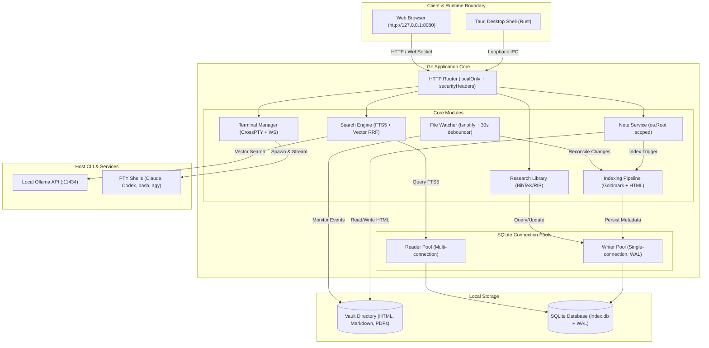
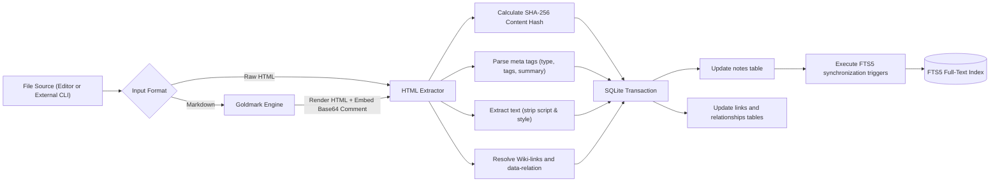
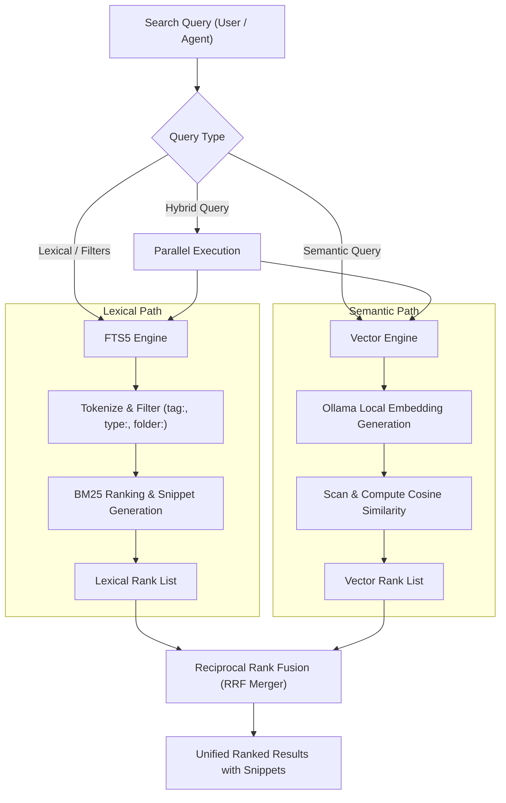
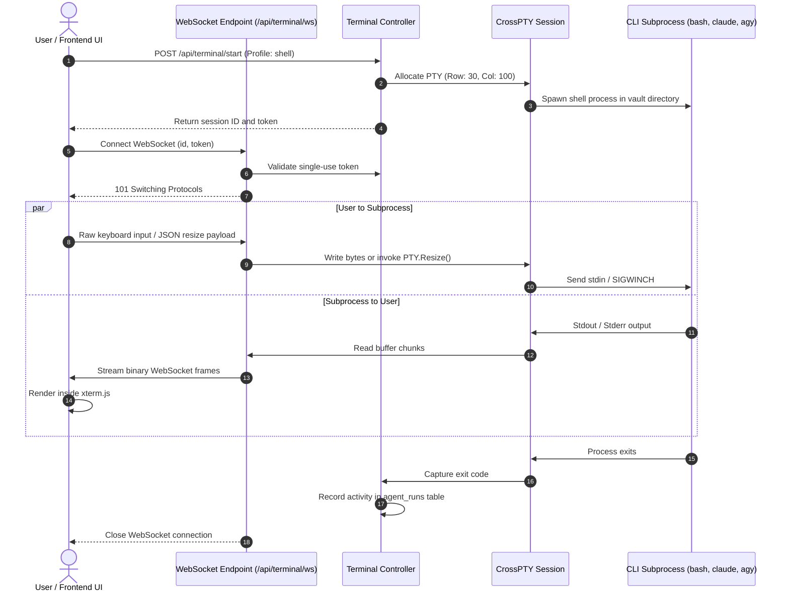
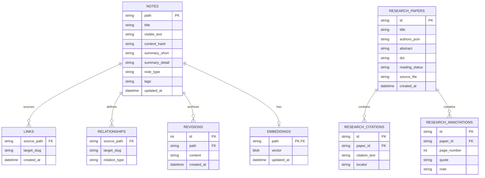
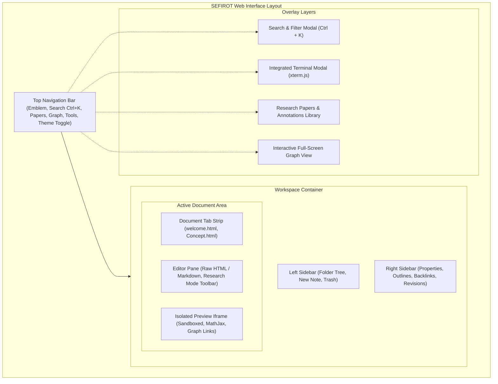

# High Level Design (HLD): SEFIROT

## 1. Executive Summary and Principles

SEFIROT is a local-first personal knowledge archive and scientific research workspace. It integrates document authoring, an interactive knowledge graph, SQLite FTS5 search, local semantic retrieval, a bibliographic research engine, and an embedded PTY terminal for autonomous AI coding agents.

### Core Design Principles

- **Local-First and Source-of-Truth**: The filesystem (`vault/`) is the durable source of truth. SQLite is a derived, rebuildable index and cache.
- **Interoperability**: Notes are stored as standard `.html` files. Markdown source is preserved within HTML comments, ensuring external editors and CLI tools can read and write without proprietary lock-in.
- **Zero-Cloud Dependency**: Runs entirely on loopback (`127.0.0.1`) without requiring remote accounts, cloud sync, or external analytics.
- **Process Isolation and Security**: The web interface isolates note preview execution inside sandboxed iframes. HTTP endpoints strictly reject non-local requests.

---

## 2. End-to-End System Architecture

---

## 3. Subsystem Architecture

### 3.1. Durable Storage and Filesystem Layer

- **Vault Directory (`vault/`)**: Contains all notes, folder structures, and static assets.
- **Document Format**: HTML5 documents. When editing in Markdown mode, Goldmark parses Markdown to HTML, embedding the raw Markdown in a Base64-encoded HTML comment: `<!--markdown-source:...-->`.
- **Atomic Operations and Path Traversal Prevention**: Filesystem access uses Go's `os.Root` to scope all disk operations within the designated vault path, rejecting relative path escapes (`../`) or symlink exploits.
- **Reconciliation Engine**:
  - Real-time indexing via `fsnotify` with a 150ms per-path debounce.
  - 30-second periodic background reconciliation pass to catch missed OS filesystem events.
  - SHA-256 content hashing to skip unchanged files.

### 3.2. Indexing and Search Engine

- **SQLite Engine**: Configured in WAL (Write-Ahead Logging) mode with `synchronous=NORMAL` and `busy_timeout=5000`. Uses a dedicated single-connection writer pool and a multi-connection reader pool to prevent database locking.
- **Lexical Search (FTS5)**: Automatic triggers synchronize document content with an external-content SQLite FTS5 table. Searches support prefix matching, exact phrases, tags (`tag:systems`), note types (`type:concept`), and folder scoping (`folder:notes`).
- **Semantic and Hybrid Search**:
  - Local embedding generation via Ollama on loopback.
  - Vector similarity calculation stored directly in SQLite tables.
  - Hybrid search combines FTS5 BM25 lexical ranking and vector similarity using Reciprocal Rank Fusion (RRF).

### 3.3. Knowledge Graph and Archive Context Protocol

- **Link Resolution**: Notes define connections via Wiki-links (`[[Target Note]]`) or HTML anchors with `data-wikilink="target"`.
- **Typed Semantic Relationships**: Links specify relations via `data-relation` attributes (such as `depends-on`, `implements`, `extends`, `contradicts`, `references`).
- **Archive Context Protocol (`GET /api/ai/context`)**: Returns a compact payload containing the target document's metadata, three-tier summaries (short graph label, note summary, and archive context), heading outlines, backlinks, and typed relationships. Designed specifically for external AI CLI agents.

### 3.4. Research and Scientific Authoring Subsystem

- **Academic Metadata Store**: Dedicated SQLite tables (`research_papers`, `research_citations`, `research_annotations`) separate from the standard note schema.
- **Bibliography Ingestion**: Native parsing for BibTeX and RIS citation formats, DOI lookup, and manual metadata authoring.
- **PDF Vault Integration**: Original PDF papers are stored in `vault/` without modification.
- **Scientific Authoring**: Searchable TeX symbol palette, inline/display mathematical derivations, AMS equation numbering, and client-side rendering via MathJax.

### 3.5. Terminal Subsystem

- **CrossPTY Abstraction**: Uses Unix pseudo-terminals (PTY) on macOS/Linux and ConPTY on Windows 10+. The `wsl` profile is conditionally offered only on Windows hosts, defaulting to native shells (`zsh`, `bash`, `sh`) on Linux/WSL.
- **Server-Owned Sessions & Replay Buffer**: Terminal sessions are owned by the backend process rather than tied to a single transient WebSocket connection. Each session maintains a 256 KB circular output replay buffer, allowing browser tabs to reconnect or reload without losing terminal history.
- **Lifecycle & Idle Termination**: Sessions without an attached browser remain active in the background and automatically terminate after a 10-minute idle timeout.
- **WebSocket Gateway**: Terminal input and output stream over bidirectional WebSockets via `/api/terminal/ws`. Localhost and loopback aliases (`localhost`, `127.0.0.1`, `[::1]`) are validated without cross-origin rejections.
- **Process Management**: Launches user shells and CLI tools (`claude`, `codex`, `gemini`, `aider`, `agy`) in the active vault directory with resize (`SIGWINCH`) synchronization.
- **Security**: WebSocket upgrades require a cryptographically random session token (`X-Vault-Token`). Maximum of 4 concurrent sessions.

### 3.6. Presentation Layer

- **Embedded Web UI**: Static assets served directly from the Go binary via `embed.FS`, with bundled offline vendor dependencies (`xterm.js`, `addon-fit.js`, `MathJax`, `Prettier`).
- **Modular Frontend**: Vanilla JavaScript modules (`core.js`, `notes.js`, `search.js`, `graph.js`, `terminal.js`, `research.js`, `formatter.js`, `ui.js`) without heavy runtime frameworks.
- **Visual Design System**: Defined in `visual-system.css` using CSS custom properties for dual themes: warm off-white light theme and pure-black dark theme. Theme rules and base surfaces are injected into note previews so standalone HTML notes adapt smoothly to light mode.
- **Editor Ergonomics**: Includes an editor word-wrap toggle (`white-space: pre` vs `white-space: pre-wrap`) and an integrated Prettier formatter that isolates LaTeX and AMS mathematical expressions (`$$...$$`, `\(...\)`, `\[...\]`) before formatting and validates byte-for-byte equation integrity upon restoration.

### 3.7. Desktop Shell (Tauri v2)

- **Sidecar Execution**: The Tauri Rust application spawns the compiled Go binary as a sidecar process on startup.
- **Ephemeral Port Negotiation**: Passes `--port 0` and `--ready-file <path>` to the Go backend. Once the backend binds to an open loopback port and writes its URL and token to the ready-file, the Tauri WebView navigates to that address.

---

## 4. Pipeline and Sequence Diagrams

### 4.1. Document Ingestion and Indexing Pipeline

### 4.2. Search and Hybrid Retrieval Architecture

### 4.3. Terminal Subprocess and WebSocket Streaming

---

## 5. Database Entity-Relationship Model

---

## 6. Frontend Layout and Component Structure

---

## 7. Security Architecture

1. **Loopback-Only Binding**: Server binds exclusively to `127.0.0.1`. The `localOnly` middleware verifies that the HTTP `Host` header resolves strictly to `127.0.0.1` or `localhost`.
2. **Cross-Origin Protection**: Rejects requests where the `Origin` header does not match the active server port, preventing malicious websites in other browser tabs from querying the API.
3. **HTTP Security Headers**: Every response sets `X-Content-Type-Options: nosniff`, `X-Frame-Options: DENY`, `Referrer-Policy: no-referrer`, and `Cache-Control: no-store`.
4. **Isolated Note Previews**: User-authored HTML and embedded scripts render within a separate `<iframe id="preview">` with sandboxing constraints to protect the management UI.
5. **Path Sandboxing**: All filesystem reads and writes pass through Go's `os.Root` boundary, blocking symlink escapes and directory traversal attacks.

---

## 8. Technology Stack Summary

| Layer               | Technologies                                                              |
| ------------------- | ------------------------------------------------------------------------- |
| Desktop Container   | Tauri v2, Rust 2021 edition                                               |
| Backend Server      | Go 1.25+ / Go 1.26, standard library `net/http`                           |
| Persistence & Index | SQLite 3 via `modernc.org/sqlite`, FTS5, WAL mode                         |
| Parsing & Watcher   | Goldmark (Markdown), `golang.org/x/net/html`, `fsnotify`                  |
| Terminal & PTY      | CrossPTY (`github.com/Kodecable/crosspty`), Gorilla WebSocket             |
| Local AI Search     | Ollama HTTP loopback API (optional)                                       |
| Frontend Core       | HTML5, Vanilla JavaScript (ES modules), CSS Custom Properties             |
| Frontend Assets     | MathJax 3 (`mathjax-full`), xterm.js (`@xterm/xterm`, `@xterm/addon-fit`) |
